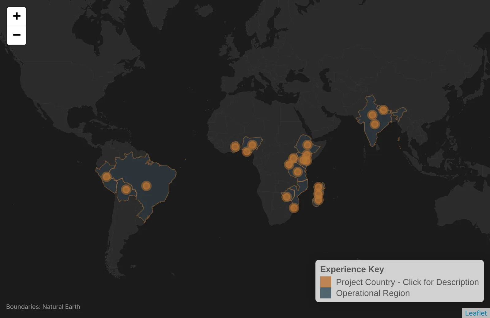

```{=html}
<section class="band column-screen">

<div class="band-inner"><div class="band-text">
<p class="hero-question" role="heading" aria-level="1">How do we know whether people and the landscapes they depend on are changing, with enough confidence to act on it?</p>
<p class="hero-sub">Mirrormere Labs measures change in poverty and wellbeing, biodiversity, and land use and land cover, combining household surveys and satellite data with rigorous evaluation design. I work with development programmes and their funders, as well as businesses working with nature, to turn complex programmes into outcomes that can be measured and acted upon.</p>
<div class="actions"><a class="btn-solid" href="services.html">See services</a><a class="btn-line" href="contact.html">Get in touch</a></div>
</div></div>
</section>
```

## What I can do for you

::: {.services-grid}
::: {}
### Impact evaluation

Independent mid-term reviews and impact evaluations, using theory-based or quasi-experimental designs and assessed against the OECD-DAC criteria.
:::

::: {}
### Monitoring and adaptive management

Theories of Change, results frameworks, indicators, and MEL systems designed so that teams can learn from their data and adjust their approach during implementation.
:::

::: {}
### Satellite data

Mapping of land cover, forest, cropland, and settlement change at landscape scale, with accuracy and uncertainty reported alongside every estimate.
:::

::: {}
### Nature-based solutions

Baselines and outcome measurement for restoration and conservation projects, covering ecological change and its effects on local livelihoods.
:::

::: {}
### Social and environmental outcomes

Wellbeing and poverty measured alongside ecological change, from household surveys through to district-level estimates.
:::

::: {}
### Clear outcomes from complex ideas

Translating ambitious programmes into a small set of outcomes that boards and investors can understand and track over time.
:::
:::

[More on services and how I work](services.qmd)

## Selected work

::: {.project}
::: {.meta}
**Madagascar, Bolivia, Kenya, Nepal, Zambia** \
NIRAS for UK Defra, 2026
:::
::: {}
### [Mid-term review: Scaling Equitable Governance in Area-Based Conservation](work/index.qmd#evaluations)

An independent review of a programme scaling a tool for assessing governance and equity in protected and conserved areas, including fieldwork in Madagascar.
:::
:::

::: {.project}
::: {.meta}
**Kenya, Uganda, Madagascar, India, Peru, Brazil** \
NIRAS for UK Defra, 2024
:::
::: {}
### [Mid-term review: Global Biodiversity Standard](work/index.qmd#evaluations)

A review of an independent standard for verifying biodiversity outcomes in nature-based restoration, with fieldwork in Kenya and remote data collection in five more countries.
:::
:::

::: {.project}
::: {.meta}
**Mozambique** \
Research, in progress
:::
::: {}
### [District poverty in Mozambique](work/mozambique-poverty.qmd)

Poverty estimates for all 157 districts, built from the 2022–23 Demographic and Health Survey and open geospatial data, with uncertainty reported for every district.
:::
:::

[All evaluations and research](work/index.qmd)

## Who I work with

[The Mastercard Foundation, the Rockefeller Foundation, UK Defra (the Biodiversity Challenge Funds and the Biodiverse Landscapes Fund), FCDO, IDRC, Royal Botanic Gardens Kew, NIRAS, WUSC, NERC, and the Scottish Funding Council.]{.funders}

## Where I have worked

::: {.map-wrap}
```{=html}
<button class="map-facade" type="button" data-src="/Where-I-work-Map/" data-title="Interactive map of evaluation, research and policy projects" aria-label="Load the interactive map of projects">
  
  <span class="map-facade-label">Explore the interactive map</span>
</button>
```
:::

[Evaluation and research projects across Africa, South America, and South Asia. [Open the map full screen](https://mirrormerelabs.github.io/Where-I-work-Map/), or see [the code behind it](https://github.com/mirrormerelabs/Where-I-work-Map).]{.map-note}

::: {.contact-strip}
::: {}
## Working together

I am available for evaluation and geospatial work with development programmes and their funders, and with businesses working on nature and climate. You can email me at [](mailto:), or download my [CV](files/Peter-Hargreaves-CV.pdf).
:::
::: {}
[Get in touch](contact.qmd){.btn-solid}
:::
:::
