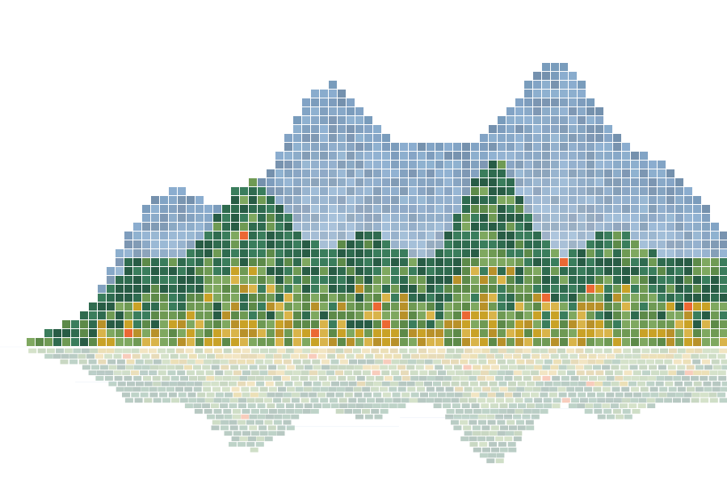

```{=html}
<section class="band column-screen">

<div class="band-inner"><div class="band-text">
<p class="hero-question" role="heading" aria-level="1">How do we measure where people are poor, and how that changes, well enough to direct policy and resources?</p>
<p class="hero-sub">Mirrormere Labs helps development programmes, funders and nature-focused businesses measure what their work changes for people and nature. I combine impact evaluation, monitoring, household surveys and satellite data, and turn complex programmes into outcomes you can measure and act on.</p>
<div class="actions"><a class="btn-solid" href="services.html">See services</a><a class="btn-line" href="contact.html">Get in touch</a></div>
</div></div>
</section>
```

## What I can do for you

::: {.services-grid}
::: {}
### Impact evaluation

Independent mid-term reviews, baselines and impact evaluations, theory-based or quasi-experimental, against the OECD-DAC criteria.
:::

::: {}
### Monitoring and adaptive management

Theories of Change, results frameworks, indicators and MEL systems that help teams learn and adjust as they go.
:::

::: {}
### Satellite data

Land cover, forest, cropland and settlement change mapped at scale, with accuracy and uncertainty stated.
:::

::: {}
### Nature-based solutions

Baselines and outcome measurement for restoration, conservation and other nature-based projects.
:::

::: {}
### Social and environmental outcomes

Livelihoods, wellbeing and poverty measured alongside ecological change, from household surveys to district-level estimates.
:::

::: {}
### Clear outcomes from complex ideas

Turning ambitious programmes into a few outcomes that boards, investors and funders can understand and track.
:::
:::

[More on services, and how I work](services.qmd)

## Selected work

::: {.project}
::: {.meta}
**Madagascar, Bolivia, Kenya, Nepal, Zambia** \
NIRAS for UK Defra, 2026
:::
::: {}
### [Mid-term review: Scaling Equitable Governance in Area-Based Conservation](work/index.qmd#evaluations)

An independent review of a programme scaling a tool for assessing governance and equity in protected and conserved areas, including fieldwork in Madagascar.
:::
:::

::: {.project}
::: {.meta}
**Kenya, Uganda, Madagascar, India, Peru, Brazil** \
NIRAS for UK Defra, 2024
:::
::: {}
### [Mid-term review: Global Biodiversity Standard](work/index.qmd#evaluations)

A review of an independent standard for verifying biodiversity outcomes in nature-based restoration, with fieldwork in Kenya and remote data collection in five more countries.
:::
:::

::: {.project}
::: {.meta}
**Mozambique** \
Research, in progress
:::
::: {}
### [District poverty in Mozambique](work/mozambique-poverty.qmd)

Poverty estimates for all 157 districts, built from the 2022–23 Demographic and Health Survey and open geospatial data, with uncertainty reported for every district.
:::
:::

[All evaluations and research](work/index.qmd)

## Who I work with

[Mastercard Foundation, the Rockefeller Foundation, UK Defra (Biodiversity Challenge Funds and the Biodiverse Landscapes Fund), FCDO, IDRC, Royal Botanic Gardens Kew, NIRAS, WUSC, NERC and the Scottish Funding Council.]{.funders}

## Where I've worked

::: {.map-wrap}
<iframe class="map-frame" src="https://mirrormerelabs.github.io/Where-I-work-Map/" title="Interactive map of evaluation, research and policy projects" loading="lazy"></iframe>
:::

[Evaluation, research and policy projects across Africa, South America and South Asia. [Open the map full screen](https://mirrormerelabs.github.io/Where-I-work-Map/), or see [the code behind it](https://github.com/mirrormerelabs/Where-I-work-Map).]{.map-note}

::: {.contact-strip}
::: {}
## Need evidence on what your work is changing?

I take on evaluations, monitoring and satellite-data work for development programmes, funders, and nature and climate businesses. Email me at [](mailto:), or download my [CV](files/Peter-Hargreaves-CV.pdf).
:::
::: {}
[Get in touch](contact.qmd){.btn-solid}
:::
:::
